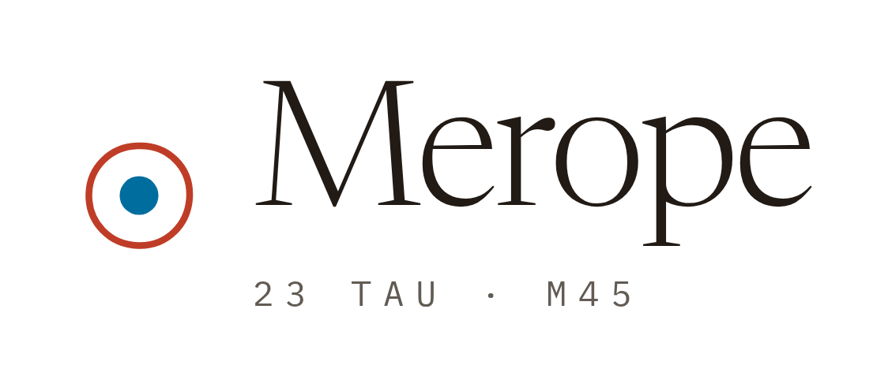

<!--
  Generated from github.com/ahmedsaed/merope by `pnpm org:profile`.
  Edits made here are overwritten on the next run: change the catalogue there.
-->

  <picture>
    <source media="(prefers-color-scheme: dark)" srcset="./assets/lockup-sky.png">
    
  </picture>

**A studio for things worth looking twice at.**

Merope is a software studio of one. It builds a small number of things, keeps them running afterwards, and writes down what that takes. It is run by [Ahmed Saed](https://github.com/ahmedsaed).

The code lives on [@ahmedsaed](https://github.com/ahmedsaed), and every studio repository there
carries the [`merope`](https://github.com/search?q=user%3Aahmedsaed+topic%3Amerope&type=repositories) topic. This organisation is the studio's
name on GitHub, not a second home for the work. The catalogue, the notes and
every release are at **[merope.dev](https://merope.dev)**.

### Catalogue

Measured on the scale a star's brightness is measured on: lower is brighter, and
six is the limit of what the eye can see unaided.

| m | Project | | Code |
| --- | --- | --- | --- |
| 1 | [Chessmark](https://merope.dev/projects/chessmark) | LLM agents playing chess, against each other and against you — a benchmark where every token, tool call and reasoning trace is recorded and replayable. | [ahmedsaed/chessmark](https://github.com/ahmedsaed/chessmark) |
| 2 | [Peace](https://merope.dev/projects/peace) | An expense tracker that keeps its mouth shut. Every record lives in one SQLite file on your phone — no account, no server, no sync, and nothing on the network unless you ask for it. | [ahmedsaed/Peace](https://github.com/ahmedsaed/Peace) |
| 3 | [merope.dev](https://merope.dev/projects/merope-dev) | The studio itself — landing page, notes, changelogs, and the design system everything else inherits. | [ahmedsaed/merope](https://github.com/ahmedsaed/merope) |
| 3 | [Pleione](https://merope.dev/projects/pleione) | An IPTV player for LG and Samsung TVs. Your own playlists and accounts, a real programme guide, and every screen laid out for a remote with four arrows on it. | [ahmedsaed/pleione](https://github.com/ahmedsaed/pleione) |
| 4 | [Lithophane Cube Maker](https://merope.dev/projects/lithophane-maker) | Five photos in, a 3D-printable lithophane lamp out — four sides, a top, and the frame that holds them, built entirely in your browser and free down to the fifth panel. | [ahmedsaed/lithophane-maker](https://github.com/ahmedsaed/lithophane-maker) |
| 5 | [makhzan](https://merope.dev/projects/makhzan) | The hardware store Egypt does not have. One place to find what a project needs — wood, metal, electronics, springs, pipe — assembled from the shops that already sell it. | — |

1 flagship · 2 established · 3 live · 4 working · 5 faint · 6 naked-eye limit

### The name

Merope is one of the seven Pleiades, the sister most commonly identified as
the _Lost Pleiad_. She is not the faintest of them, whatever popular astronomy
says: at magnitude 4.18 she is the fourth-brightest of the seven. The
wisps around her, NGC 1435, are not what is left of the cloud the cluster
formed from. They are an unrelated cloud the cluster happens to be drifting
through, and they glow only because her light falls on them.

> The star is not the point. What it lights up is.

<code>23 Tau · 03h 46m 19.59s +23° 56′ 54.09″ · B6IV(e) · m4.18</code>
